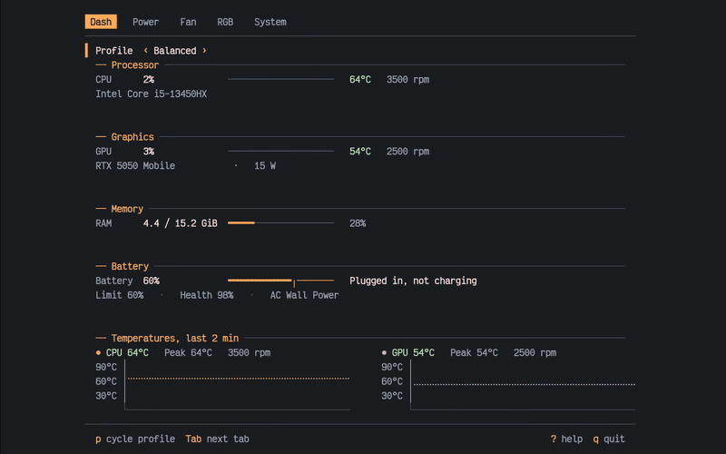
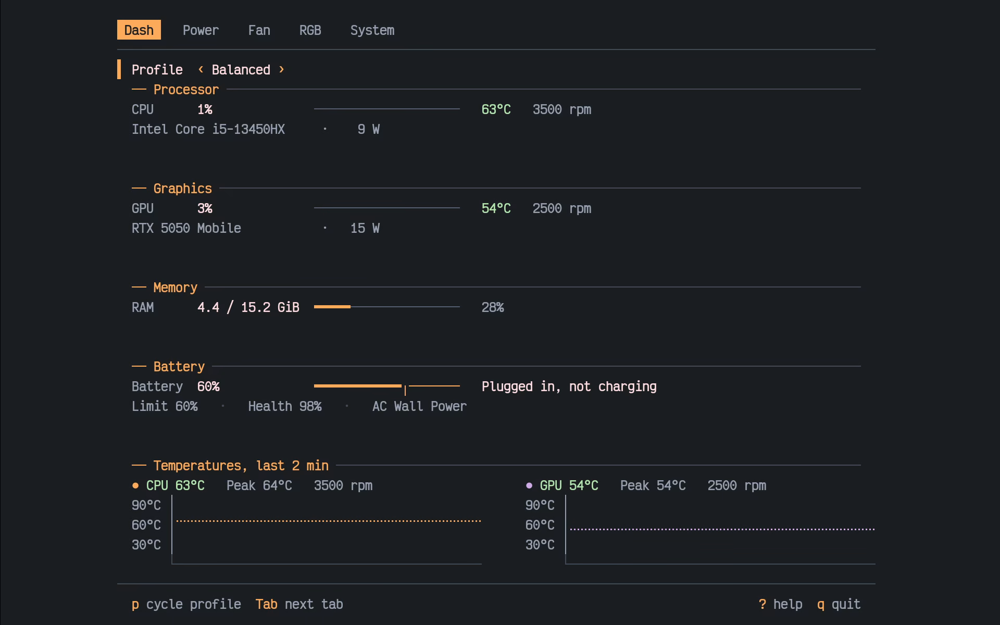
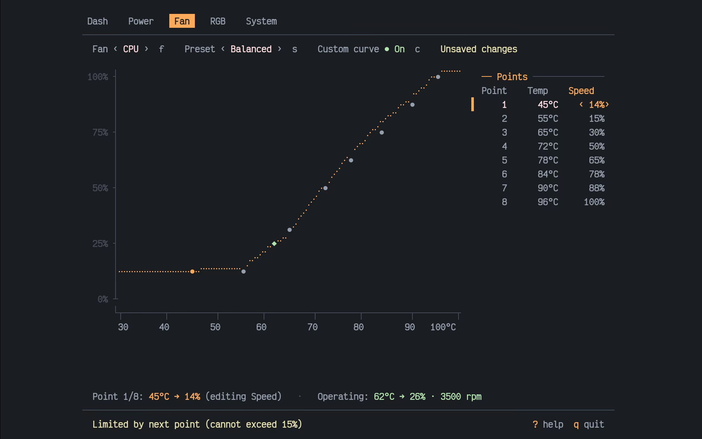
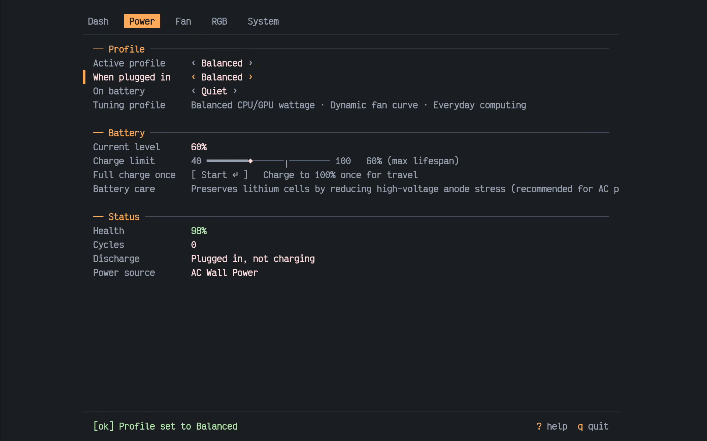
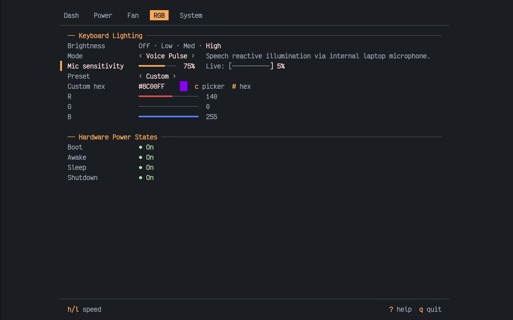

<div align="center">
  
  <h1>rogtui</h1>
  <p><strong>A sleek, lightweight hardware control center for ASUS ROG and TUF laptops on Linux.</strong></p>
  <p>Like G-Helper, but built natively for your terminal. Fast, keyboard-driven, and zero bloat.</p>

  <p>
    <a href="https://crates.io/crates/rogtui"></a>
    <a href="LICENSE"></a>
    <a href="https://kernel.org"></a>
    
    
  </p>
</div>

---



> Full-resolution 60 FPS video demonstration available at [assets/demo.mp4](assets/demo.mp4).

---

## What Can rogtui Do?

`rogtui` provides full hardware control for ASUS ROG and TUF laptops through a clean, modern terminal interface. Built in pure Rust, it launches in under 2ms, uses 0.0% CPU when idle, and speaks directly to `asusd` and `supergfxd` over system D-Bus.

### Performance & Fan Curve Studio
- **Instant Profile Switching:** Toggle between Quiet, Balanced, and Performance modes on the fly (`p`).
- **8-Point Custom Fan Curves:** Calibrate custom temperature-to-PWM fan curves for CPU and GPU fans with live thermal marker tracking (`◆`).
- **AC / Battery Auto-Switching:** Automatically switch profiles when connecting or disconnecting the charger.
- **Safety Clamps:** Enforces non-decreasing fan curves and emergency cooling minimums above 80°C.

### Battery Lifespan & Power
- **Health Charge Limiter:** Set charging caps at 60% or 80% to prolong battery lifespan.
- **One-Shot Travel Override:** Charge to 100% for travel with a single keystroke (`Start ↵`), automatically resetting back to your health limit once unplugged.
- **Live Battery Wattage:** Real-time charge and discharge rates with threshold indicators.

### 18 Dynamic RGB Effects & Reactive Audio
- **Hardware Aura Modes:** Static, Breathe (with synchronized primary & secondary colors), Rainbow Cycle, and Pulse.
- **Microphone Voice Pulse:** Keyboard illuminates and dances in real-time to speech picked up by your microphone, complete with an adjustable sensitivity meter.
- **Audio Pulse & Wave:** Cava-style frequency spectrum visualizer directly across your keyboard backlight.
- **Ambient Screen Sync:** Matches keyboard colors to your active desktop window or wallpaper via Wayland.
- **Dynamic Desktop Theme Sync:** Smart palette detection synchronizes your keyboard with your active desktop theme and terminal accent colors.
- **Background Daemon:** Keep software RGB effects running smoothly in the background even after exiting (`rogtui-close` / `rogtui --daemon`, <0.2% CPU).
- **Slash LED Controls:** Automatically detected on supported Zephyrus models.
- **Interactive Color Picker:** 24-bit RGB/HSV color picker modal (`c`) and direct hex entry (`#`).

### Live Telemetry Dashboard
- **Sensor Monitoring:** Instant CPU and GPU temperatures with 2-minute Braille history charts.
- **Accurate Power Draw:** Real-time CPU package power in Watts and dGPU power monitoring (gracefully indicating `D3cold (0 W)` when suspended).
- **Aligned Specifications:** Clean hardware summary with memory, processor, and graphics telemetry.

### Display & Graphics MUX
- **Panel Overdrive:** Toggle 3ms response time overdrive on supported high-refresh panels.
- **GPU Mode Switching:** Integrated, Hybrid, and dedicated GPU MUX switching integration via `supergfxd`.
- **System Diagnostics:** Export comprehensive markdown diagnostic reports with one key (`y`).

---

## Screenshots

| Telemetry Dashboard | Fan Curve Calibration |
| :---: | :---: |
|  |  |

| Power & Battery Lifespan | RGB Lighting & Reactive Voice |
| :---: | :---: |
|  |  |

---

## Installation

> Note: AUR package registration is temporarily closed upstream due to an Arch Linux automated account creation pause. In the meantime, install directly via Cargo or compile locally using the included PKGBUILD.

### Cargo (crates.io)

```bash
cargo install rogtui
```

### Arch Linux / CachyOS (Local PKGBUILD)

```bash
git clone https://github.com/manisk/rogtui.git
cd rogtui
makepkg -si
```

### Build from Source

Requires Rust 1.80+:

```bash
git clone https://github.com/manisk/rogtui.git
cd rogtui
cargo build --release
install -Dm755 target/release/rogtui ~/.local/bin/rogtui
```

---

## Controls & Shortcuts

| Key | Context | Action |
| :--- | :--- | :--- |
| `Tab` / `Shift+Tab` | Global | Switch to next / previous tab |
| `1` .. `5` | Global | Jump directly to Dash, Power, Fan, RGB, or System |
| `j` / `k` or `Up` / `Down` | Lists | Navigate controls and menu items |
| `h` / `l` or `Left` / `Right` | Sliders / Menus | Adjust values, change presets, or cycle options |
| `Enter` / `Space` | Controls | Activate button, confirm modal, or open color picker |
| `c` | RGB / Fan | Open color picker modal (RGB) / toggle custom fan curve (Fan) |
| `#` | RGB | Enter 6-digit hex color directly (e.g. `ff4080`) |
| `p` | Global | Quick cycle active Platform Profile |
| `w` | Fan | Write staged fan curve to hardware EC |
| `r` | Fan | Reset selected fan curve to factory BIOS defaults |
| `f` | Fan | Toggle CPU / GPU fan curve selection |
| `y` | System | Export full markdown diagnostic report |
| `?` | Global | Open keyboard shortcuts help modal |
| `q` / `Esc` | Global | Dismiss modal / exit application |

---

## Background Daemon

Software RGB animations, reactive microphone meters, and ambient screen sync can run headlessly after closing the UI:

- **Launch background daemon:** `rogtui --daemon`
- **Stop background daemon:** `rogtui-close` or `pkill -f "rogtui --daemon"`
- **Resource overhead:** Consistently under 0.2% CPU and ~6 MiB RSS.

---

## Hardware Compatibility

`rogtui` supports all ASUS laptops supported by the Linux kernel ASUS WMI drivers and the `asus-linux.org` daemon stack:

- **ROG Zephyrus:** G14, G15, G16, M16, Duo 15/16
- **ROG Strix / SCAR:** Strix G15-G18, SCAR 15-18
- **TUF Gaming:** A15, A16, F15, F16, Dash series (FA506, FA507, FX506, FX507, FX607, FX608)
- **ROG Flow & Handhelds:** X13, X16, Z13, ROG Ally, ROG Ally X

### Requirements
- Linux kernel 6.1+ with `asus_wmi` module
- `asusd` v6.5.0+ (`systemctl is-active asusd`)
- `supergfxd` v5.2.7+ (for GPU switching)

---

## Documentation

For technical specifications, D-Bus interfaces, and architecture deep-dives:
- [`docs/rogtui-hardware-control.md`](docs/rogtui-hardware-control.md): Hardware control architecture and Aura algorithms.
- [`docs/asusctl-architecture-and-effects.md`](docs/asusctl-architecture-and-effects.md): Complete D-Bus endpoints and sysfs telemetry.
- [`docs/parity.md`](docs/parity.md): Feature parity comparison with Armoury Crate and G-Helper.

---

## License

Licensed under either of Apache License, Version 2.0 ([LICENSE-APACHE](LICENSE-APACHE)) or MIT license ([LICENSE-MIT](LICENSE-MIT)) at your option.
